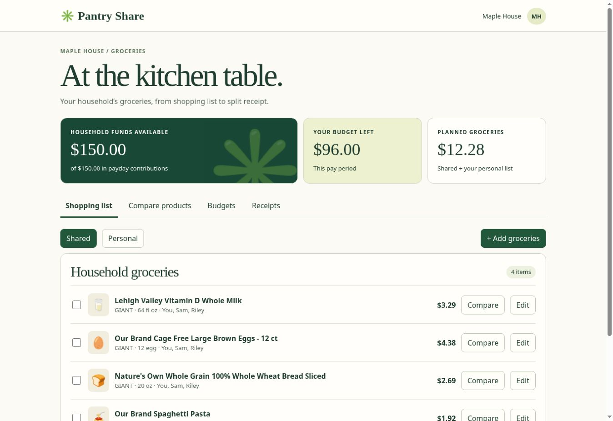

# Pantry Share

When one roommate buys the groceries and another buys the cleaning supplies, a receipt rarely splits evenly. Pantry Share keeps the list, the receipts and the repayments together so each person can see what they owe.

[Open the hosted demo](https://pantry-share-roommates.dehuathemlgpro.chatgpt.site)

## Try it with a roommate

1. In **Budgets**, name your household and its members. Set an optional calendar-month spending limit. Each person can separately budget a share of their paycheck on their own payday schedule.
2. In **Shopping list**, add a catalog product or type a custom item. Set the number of packages and each roommate’s share. A share of two counts twice as much as a share of one.
3. Select purchased items and enter the final receipt total, date and payer. Pantry Share allocates the total across those items by their estimated cost, down to the cent. In **Receipts**, correct mistakes, attach a photo, buy an item again or record an actual repayment.
4. Use **Pantry** to track food and supplies, owners and expiry dates. Mark something as out to add it to the list. Mark a trip done to pass the shopping turn to the next person.
5. In **Budgets → Share your household**, export the shared file and send it to your roommates. On import, choose your name and review the replacement. Take turns editing the latest copy. Your paycheck, personal groceries and receipt photos stay on your device. Private recovery downloads contain personal data.

## Catalog and estimates

The demo includes 132 listings across 15 stores. Philadelphia-area choices include ShopRite, Trader Joe’s, The Fresh Grocer, Lidl and H Mart. Browse one retailer at a time and filter by dietary preferences. Select a product to compare package cost, unit price and specialty features. Retailer links are the place to check the actual price, ingredients and availability. Historical demo estimates show their recording date. New listings show a price review date when available. Retailer photos load from the original host and may become unavailable. Retailers retain rights to their content.

The tax estimate covers supported Philadelphia locations and the listed product types. It includes taxable supplies such as paper towels, detergent and trash bags. Residential toilet tissue is exempt. Unclassified items can be entered with their tax-inclusive receipt total. The location field refers to the shopping or delivery location. [Philadelphia Department of Revenue](https://www.phila.gov/services/business-self-employment/business-taxes/sales-use-hotel-occupancy-tax/) · [Pennsylvania Retailer's Information Guide](https://www.pa.gov/content/dam/copapwp-pagov/en/revenue/documents/formsandpublications/formsforbusinesses/sut/documents/rev-717.pdf)

## Run and test

Serve the static app with `python3 -m http.server 8000 --directory docs`, then open `http://localhost:8000`. Run `npm test` with Node 22 or later. For the phone-sized browser tests, run `npm ci`, `npx playwright install chromium`, then `npm run test:browser`.

## Roadmap

The current release uses local saves and manual household file handoffs. The next step is account-based households with invitation codes and conflict-aware syncing across devices. Live retailer pricing and availability depend on access to retailer data.
